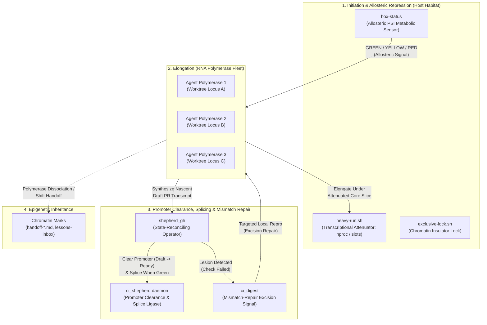

# 🦑 squid-bot

**Transcriptional regulation for autonomous coding fleets: dynamic transcription factors that govern compute, CI checkpoints, and information flow so agent swarms express verified code without devouring their host.**

[](https://github.com/squid-protocol/squid-bot/actions/workflows/tests.yml)
[](https://github.com/squid-protocol/squid-bot/actions/workflows/dashboard.yml)
[]()
[]()
[](LICENSE)

---

## ⚡ The 15-Second Pitch: The Grasshopper Problem

> You give 5 autonomous coding agents tasks simultaneously.
>
> Ten minutes later: your machine fans are howling, CPU load is 74 on a 12-core box, tests time out randomly because regex engines were starved of clock cycles, your GitHub Actions queue is backed up for two hours, and two agents crashed mid-sentence because the kernel ran out of memory.

Autonomous agents are greedy by default. Left unmanaged, an agent population behaves like a **plague of grasshoppers**—they consume every available core, saturate disk I/O, burn through CI budgets with speculative PRs, and trample shared state until their host habitat collapses.

At a glance, `squid-bot` looks like an ecological governor that keeps the swarm within its habitat's carrying capacity. **Under the hood, what it actually builds is an operon**: a self-regulating system of **dynamic transcription factors** that govern how information flows from your issue backlog into `main`—regulating initiation, throttling elongation under metabolic stress, pausing drafts at promoter checkpoints, excising point failures locally, and splicing only verified transcripts into the genome.

---

## 📊 Live Fleet Dashboard


Live numbers from the GitHub API for [GitGalaxy](https://github.com/squid-protocol/gitgalaxy), the repository squid-bot runs on, refreshed every 6 hours. Raw data: [`metrics.json`](https://github.com/squid-protocol/squid-bot/blob/dashboard/metrics.json).

It's made by this repo's **[Fleet CI report action](actions/fleet-report)**. Add it to any repo to get the same dashboard plus a weekly report: CI cost and queue wait per merged PR, split between agent-made and other PRs, and how many reruns passed versus failed again (a rerun that fails again almost always retried a real failure), with the method published.

---

## 🧬 From Swarm to Operon: Regulating Information Flow

The grasshopper analogy explains why an *unmanaged* swarm crashes a machine, but grasshoppers in a field are independent organisms competing for grass—they are not collaborating to synthesize and maintain a **single shared genome (`origin/main`)** under strict proof constraints.

A high-velocity autonomous code factory is not a pasture; it is a **gene-regulatory network (an operon)**.

In molecular biology (from Jacob & Monod's *lac* and *trp* operons to eukaryotic transcription networks), the cell's core engineering problem is identical to autonomous software engineering: **how do you transcribe DNA into functional proteins at maximum throughput without exhausting cellular ATP or allowing misfolded, mutated transcripts into the organism?**

```
┌──────────────────────────────────────────────────────────────────────────────┐
│                     THE GENOME (origin/main + Issue Backlog)                 │
│                                                                              │
│   ═══╡ Locus #4893 ╞═══╡ Locus #5166 ╞═══╡ Operator ╞═══╡ Promoter ╞═══      │
│        (Issues, specs, and unported programs waiting to be expressed)        │
└──────────────────────────────────────┬───────────────────────────────────────┘
                                       │
            1. Initiation Gated by Allosteric Metabolic Sensors
               • box-status (PSI stall sensor: GREEN / YELLOW / RED)
               • Represses new transcription when cellular ATP (CPU/RAM/IO) drops
                                       │
┌──────────────────────────────────────▼───────────────────────────────────────┐
│              RNA POLYMERASES (Claude Code / Gemini / Cursor)                 │
│                                                                              │
│   Bind to an isolated worktree locus and synthesize a nascent transcript     │
│   (branch + Draft PR), paced by heavy-run.sh (transcriptional attenuation)   │
└──────────────────────────────────────┬───────────────────────────────────────┘
                                       │
            2. Promoter-Proximal Pausing & Post-Transcriptional Proofreading
               • Draft PR pauses heavy CI until cheap fast-gates clear
               • ci_digest isolates point mutations & dispatches local MMR repro
               • ci_shepherd + shepherd_gh reconcile state & splice into main
                                       │
┌──────────────────────────────────────▼───────────────────────────────────────┐
│                    EXPRESSED PHENOTYPE (Verified Squash Merge)               │
│                                                                              │
│   Clean, proven code ligated into origin/main; epigenetic marks written      │
│   to handoff-*.md and lessons-inbox.md for the next generation of agents     │
└──────────────────────────────────────────────────────────────────────────────┘
```

### The Operon Mapping: How Every Component Regulates Information Flow

| Molecular Biology (The Operon) | `squid-bot` Transcription Factor | Information-Flow Role |
|---|---|---|
| **The Genome (`DNA`)** | **`origin/main` + Issue Backlog** | The canonical sequence of truth. Every issue or unported module is a structural gene waiting to be expressed into verified production code. |
| **RNA Polymerase (`RNAP`)** | **Coding Agents** *(Claude, Gemini, Cursor)* | Processive, energy-hungry enzymes that bind to a locus (worktree) and synthesize a nascent transcript (branch / PR). Left unregulated, they transcribe everything at once and deplete cellular ATP. |
| **Allosteric Metabolic Sensor (`AMPK` / *trp* Repressor)** | **`box-status` (`GREEN` / `YELLOW` / `RED` PSI)** | Senses real-time cellular energy stall (`/proc/pressure/cpu`, `memory`, `io`). When stall pressure rises, it allosterically represses new transcription initiation before the host hits metabolic collapse. |
| **Transcriptional Attenuation** | **`heavy-run.sh` (`nproc / active_slots`)** | Dynamically modulates elongation speed mid-transcription—slicing thread pools (`SQUID_BOT_CORES`) so concurrent polymerases share cores without starving each other's clock cycles. |
| **Promoter-Proximal Pausing** | **Draft PR $\rightarrow$ Ready Gate** | In cells, RNA Polymerase pauses ~50 bp after initiation for cheap quality checks before committing to expensive full-gene elongation. Draft PRs run only fast lint/audit checks until `ci_shepherd` clears the promoter to trigger heavy CI. |
| **Spliceosome & Feedback Repressors** | **`shepherd_gh.py` & `ci_shepherd.py`** | State-reconciling transcription factors (`shepherd:merge`, `shepherd:hold`, `shepherd:waiting-on-main`) that govern whether a mature transcript is spliced into `main` or held back via negative feedback when `main` itself is red. |
| **Mismatch Repair (`MMR`) & Excision Signaling** | **`ci_digest.py`** | Instead of flooding the agent's context window with toxic 10,000-line raw logs, classifies the lesion (`real` vs `infra`/`flake`/`main`/`dirty`) and dispatches a targeted local excision-repair command. |
| **Epigenetic Chromatin Marks** | **Handoffs (`handoff-*.md`), `lessons-inbox.md`, the shepherd's event ledger & `flake-history`** | Individual polymerase complexes dissociate when context windows compact or sessions end; epigenetic marks preserve reading-frame state and learned regulatory rules across agent generations. The shepherd keeps its own marks too: a bounded ledger of reruns, merges and fixer starts, and the set of checks that history shows are flaky. |

### What Happens Without Transcriptional Regulation

| Cellular / Host Resource | Unregulated Polymerase Swarm | Operon Regulation (`squid-bot`) |
|---|---|---|
| **CPU Cores & Threads** | Every agent spawns `nproc` workers; load spikes to 60+; clock starvation triggers false regex/test timeouts. | `heavy-run.sh` attenuates elongation speed to fair-share cores (`online_cores / active_heavy_slots`). |
| **Memory & Swap** | Concurrent AST parsers, JVMs, and containers exhaust RAM; OOM killer terminates active agent sessions. | `box-status` senses `/proc/pressure/memory` stall and represses heavy initiation (`YELLOW` / `RED`). |
| **CI Runner Minutes** | Agents push speculative commits to test hypotheses on GitHub Actions, exhausting runner queues. | Draft pausing + `ci_digest` local repro forces mismatch repair locally before a single re-push. |
| **Shared Genome (`main`)** | Upstream merges invalidate in-flight branches; agents enter infinite rebase loops or chase `main` failures. | `shepherd_gh` serializes splicing into `main` and tags `shepherd:waiting-on-main` during negative feedback. |

---

## 🏛️ How the Regulatory Network Operates



---

## 🔍 Transcription Factor Deep Dive

### 1. Allosteric Metabolic Sensor (`box-status`)
CLI command: `box-status`

In a cell, transcription factors don't guess energy availability by counting how many enzymes exist—they sense actual metabolic stall (such as AMP/ATP ratios). Similarly, instead of relying on crude CPU percentages (which spike deceivingly during brief bursts), `box-status` queries Linux **Pressure Stall Information (PSI)** from `/proc/pressure/cpu`, `/proc/pressure/memory`, and `/proc/pressure/io`.

```bash
$ box-status
GREEN: headroom
cores 12  load 2.4 / 3.0 / 3.4  cpu-pressure 0.02%  mem-pressure 0.09%
memory available 24.3 / 30.4 GB  swap used 4.9 GB
heavy slots 0/3 held  free for new heavy work: 3
busiest (cores in use, by worktree or command):
   0.08  find
   0.05  agy
disk: io-pressure 1.79% (full 1.57%)  tasks blocked on disk 0
```

#### Allosteric Regulatory States
* **`GREEN` (Induced / Open Promoter):** Metabolic pressure is negligible and heavy slots are open. Polymerases (agents) are cleared to initiate heavy verification sweeps, Docker containers, or parallel gauntlets.
* **`YELLOW` (Attenuated Transcription):** Heavy slots are occupied, available memory is under 20%, or load exceeds 70% of core count. Agents down-shift to lightweight scouting, narrow unit tests, or code edits only.
* **`RED` (Allosteric Repression):** CPU stall pressure $\ge 40\%$, available memory $< 10\%$, or swap paging is active. The operator is bound by the repressor: orchestrators pause new agent launches immediately and instruct active workers to write epigenetic checkpoints.

---

### 2. Transcriptional Attenuator (`heavy-run.sh`)
Usage: `scripts/heavy-run.sh <command...>`

In the bacterial *trp* operon, **attenuation** decides, as transcription begins, how far a polymerase should go given the ribosome supply at that moment, so multiple polymerases don't stall on the same strand. `heavy-run.sh` does the same for compute-intensive builds and test suites, once, when each job starts:
1. It acquires one of $N$ shared slots ($N = \text{cores} / 4$, minimum 1) via kernel `flock`.
2. It senses how many other polymerases are simultaneously elongating heavy tasks.
3. It calculates a fair core share for that moment:
   $$\text{SQUID\_BOT\_CORES} = \max\left(1, \frac{\text{online\_cores}}{\text{active\_heavy\_slots}}\right)$$
4. It exports `SQUID_BOT_CORES` and `GG_JOB_CORES`, which downstream tools (pytest-xdist, compiler jobs, linters) read to size their internal worker pools.

The share is not revised while the job runs: a job that starts alone gets every core, and jobs started after it get smaller shares, so a staggered start can briefly ask for more cores than exist (about 1.8x with 3 slots). The slot count still caps how many heavy jobs run at once.

---

### 3. Promoter Clearance & Spliceosome Shepherd (`shepherd_gh.py` & `ci_shepherd.py`)
CLI command: `squid-bot run --every 600` or `shepherd`

In eukaryotic transcription, RNA Polymerase II initiates a transcript and then enters **promoter-proximal pausing** until regulatory checkpoints verify that the transcript is ready for full elongation and splicing. Furthermore, cellular regulation is driven by **chemical state equilibrium (binding affinity)**, not fragile one-shot events.

In a high-churn code factory, GitHub webhook events drop under burst traffic, arrive out of order, or get canceled by concurrency groups. The Shepherd eliminates event reliance by **reconciling the true GitHub state machine directly** on every pass:
* **Promoter-Proximal Pausing (Draft $\rightarrow$ Ready):** Agents open PRs as drafts so only cheap, fast checks run. Once fast checks pass, `ci_shepherd` clears the promoter (marks the PR ready for review) to trigger the full CI suite, and merges it on a later pass once that suite is green; it never merges a draft in the same step, because a draft's skipped heavy checks read as green. At most `CI_SHEPHERD_MAX_IN_FLIGHT` (default 4) drafts are released per pass, so a burst of drafts doesn't flood the CI runners.
* **Spliceosome Ligation (`shepherd:merge`):** The moment all required checks pass and the branch is clean, the shepherd squash-merges the transcript into `main`.
* **No Chasing `main`:** A PR that is merely *behind* `main` is never updated just to stay current: every push restarts its CI. Leave branch protection's "require branches to be up to date" off and let `main`'s own CI catch the rare semantic conflict; with it on, a green-but-behind PR waits for a human.
* **Proofreading Reruns:** `infra` failures are rerun up to 3 times, 15 minutes apart, and `flake` failures once. The budget belongs to the workflow run, not the check: the failing legs of one matrix run share a single `gh run rerun --failed`.
* **Catabolite Repression (fixer gating):** With `CI_SHEPHERD_FIXER` set, a `real` failure starts that command (`<fixer> <PR> <digest.json>`) to repair it. The digest comment posts at once, but the fixer starts only when `box-status` reads `GREEN`, at most `CI_SHEPHERD_MAX_FIXERS` (default 1) per pass, and the most useful first: the PR that others wait on (`--after`), then the one with the fewest failing checks.
* **Repressor Binding (`shepherd:hold`):** Binds the operator to hold a PR open for human inspection without merging.
* **Enhancer Activation (`shepherd:matrix`):** Induces the full cross-platform OS $\times$ Python matrix suite and gates ligation on a clean run.
* **Negative Feedback Inhibition (`shepherd:waiting-on-main`):** Automatically applied when a failing check is confirmed to also be failing on `origin/main`, preventing agents from mutating their own branch to fix a broken reference genome.
* **Excision Flagging (`shepherd:needs-fix`):** Applied when a real regression or conflict (`dirty`) is detected, paired with a structured `ci_digest` report.

---

### 4. Mismatch Repair & Excision Signaling (`ci_digest.py`)
CLI command: `ci-digest <PR_NUMBER>`

When a replication error occurs in DNA, the Mismatch Repair (`MMR`) complex (`MutS`/`MutL`) does not destroy the entire chromosome—it locates the exact mismatched base pair, nick-excises the local region, and resynthesizes that patch.

When CI fails on a PR, dumping 10,000 lines of raw GitHub Actions ANSI logs into an LLM's context window is cellular toxicity. `ci_digest` acts as the `MutS`/`MutL` recognition complex: it scans the failure, filters out environmental noise, classifies the mutation, and emits the exact local excision-repair coordinates:

```bash
$ ci-digest 4976
#4976 HEAD 5b7f5c5e
  check: full-suite part 3/3 (failure)
  triage: real (code failure)
  failed tests:
    tests/core/test_parser.py::test_utf8_bom_handling
  error:
    AssertionError: assert 'expected' == 'actual'
  local repro:
    python -m pytest tests/core/test_parser.py -k test_utf8_bom_handling
```

#### Lesion Taxonomy
* `infra`: Environmental noise (runner disconnects, Docker Hub 429/504s). The shepherd auto-heals these by retrying up to 3 times, 15 minutes apart.
* `flake`: Known timing-sensitive locus: a test listed in `FLAKY`, or the first attempt of a check that `flake-history` learned is flaky. Retried once automatically; if it fails again it is `real`.
* `main`: Lesion is on the reference strand (`origin/main`). Triggers negative feedback (`shepherd:waiting-on-main`). While `main`'s newest commit is still running a check, the last finished result of that check on `main` (up to 3 commits back) is used, so a PR is not blamed for a failure it inherited in the minutes after a merge.
* `dirty`: Reading-frame shift (merge conflict with `main`). Signals the agent to merge `origin/main` and regenerate derived artifacts.
* `real`: True point mutation in the PR transcript. Outputs the **exact local reproduction command** so the agent repairs and verifies the patch locally before pushing once.

#### Learned Flakes (`flake-history`)
CLI command: `flake-history [--json] [--file-issues]`

GitHub already records the evidence: a rerun workflow run has `run_attempt > 1`, and its jobs from every attempt are listed. `flake-history` finds the jobs that failed and then passed on a rerun of the same run over the last 14 days. A job that passed on a rerun at least twice, with at least half its reruns passing, is *learned flaky*. `ci_shepherd` refreshes that cache in the background every 6 hours and treats such a check's first failure as a `flake`. `--file-issues` opens one cleanup issue per learned-flaky job (once).

---

### 5. Epigenetic Inheritance (`handoff-*.md` & `lessons-inbox.md`)
Individual RNA polymerase molecules dissociate from the template after a finite run length; similarly, coding agents hit context window compaction, API rate limits, and session preemptions.

`squid-bot` implements **epigenetic memory** via structured markdown handoffs ([`handoff-*.md`](templates/skills/parallel-agents/SKILL.md)) and `lessons-inbox.md`:
* Before dissociating at the end of a turn or shift, an agent records active worktree loci, running background PIDs, verification levels reached, and open blockers.
* The next agent binds directly to that worktree and resumes elongation in the exact reading frame without re-running expensive proofs.
* Regulatory lessons discovered during a run are written to `lessons-inbox.md` and promoted into permanent agent rules—evolving the operon's regulatory network over time.

---

## 🛠️ Installation & Quickstart

### Prerequisites
* Linux (with `/proc` PSI support recommended for allosteric admission control).
* Python 3.10 or higher.
* GitHub CLI (`gh`) authenticated with repository access.

### 1. Install `squid-bot`
```bash
git clone https://github.com/squid-protocol/squid-bot.git
cd squid-bot
pip install -e .
```

### 2. Configure Your Operon (`squid-bot.toml`)
Create a `squid-bot.toml` in your repository root:

```toml
[repository]
slug = "owner/repo"

[shepherd]
# Required CI checkpoints before splicing a PR with shepherd:merge into main
required_checks = [
    "test",
    "lint",
    "type-check"
]
poll_interval_seconds = 600
state_path = "/tmp/squid-bot/state/shepherd.json"

[supervisor]
lock_dir = "/tmp/squid-bot/locks"
heavy_slots = 3
```

### 3. Sense Metabolic Capacity
```bash
box-status
# Output: GREEN: headroom (cores: 12, load: 2.1, free heavy slots: 3)
```

### 4. Elongate Work Under Transcriptional Attenuation
```bash
scripts/heavy-run.sh pytest tests/
```

### 5. Launch the Shepherd Transcription-Factor Daemon
```bash
nohup squid-bot run --every 600 >> /tmp/squid-bot/shepherd.log 2>&1 &
squid-bot status   # the queue, plus the ledger's most recent events
```

| Environment variable | Default | Effect |
|---|---|---|
| `CI_SHEPHERD_FIXER` | unset | Command started for a `real` failure: `<fixer> <PR> <digest.json>` |
| `CI_SHEPHERD_MAX_FIXERS` | `1` | Fixers started per pass (only while `box-status` is `GREEN`) |
| `CI_SHEPHERD_MAX_IN_FLIGHT` | `4` | Drafts marked ready per pass |

---

## 🔄 The GitGalaxy Live Crucible & Sync Bridge

`squid-bot` was forged inside **[GitGalaxy](https://github.com/squid-protocol/gitgalaxy)**, where its transcriptional regulatory network governs multi-agent churn across **5,200+ pull requests**.

To allow continuous evolution inside GitGalaxy while maintaining a clean, generalized open-source package, `squid-bot` includes a bi-directional sync bridge (`scripts/sync.py`):

```bash
# Check drift between GitGalaxy and squid-bot
python scripts/sync.py status
python scripts/sync.py diff

# Pull recent regulatory improvements from GitGalaxy into squid-bot
python scripts/sync.py pull

# Push generalized fixes from squid-bot back to GitGalaxy (see the warning below)
python scripts/sync.py push
```

The bridge translates paths, abstracts repository slugs, maps package imports, updates lock variables, and adapts test suites. `pull` is safe. **`push` is not a clean reverse:** it writes squid-bot's generalizations into GitGalaxy as well, including the default lock directory, which would split GitGalaxy's heavy-job slots between old and new agents. To move a change into GitGalaxy, `git format-patch` the commit, rewrite its paths (`src/squid_bot/X` → `tests/tools/[box/]X`, `tests/test_X` → `tests/tools/test_X`) and `git apply` it in a fresh GitGalaxy worktree.

---

## ❓ Frequently Asked Questions

#### Q: Why frame `squid-bot` as an operon / transcription-factor network instead of just a task queue?
**A:** A traditional queue only orders jobs. An operon regulates **end-to-end information flow with feedback loops**: it senses host metabolic stall before initiating work (`box-status`), sizes each heavy job's share of the cores as it starts (`heavy-run.sh`), pauses nascent drafts before expensive CI elongation (`ci_shepherd`), routes lesions to targeted local mismatch repair (`ci_digest`), and inhibits downstream splicing when the reference genome (`main`) is damaged.

#### Q: Why measure Linux PSI instead of standard CPU usage?
**A:** Traditional CPU percentages only measure how much time the processor spent on tasks, which spikes deceivingly during momentary bursts. PSI measures **task stall time**—the percentage of time processes were delayed waiting for CPU, memory, or disk access. High PSI is a direct measure of cellular energy starvation.

#### Q: Does `squid-bot` replace GitHub Merge Queue or Mergify?
**A:** No, it solves a different problem. Human merge queues assume developers submit tested code, wait patiently for CI, and read log outputs in their browser. `squid-bot` is built for **autonomous agent polymerases**: it regulates local host metabolism, eliminates token-burning polling loops, and provides structured local mismatch-repair commands designed for LLM reasoning loops.

#### Q: What happens if an agent gets killed mid-task?
**A:** `squid-bot` includes `scripts/kill-by-cwd.sh` to safely reclaim processes tied to orphaned worktrees, and `exclusive-lock.sh` / `heavy-run.sh` use POSIX kernel file locks (`flock`) that automatically release the instant a process dissociates, ensuring the operator never deadlocks.

---

## 📜 License

MIT License. Copyright (c) 2026 Joe Esquibel / Squid Protocol.
