# 🦑 squid-bot

**A controlled release of coding agents: squid-bot starts agents only as the host, CI and budget can take them, screens every change they make, and merges only verified ones into `main`, so a repository gets a steady, rolling stream of small improvements that never has to stop.**

[](https://github.com/squid-protocol/squid-bot/actions/workflows/tests.yml)
[](https://github.com/squid-protocol/squid-bot/actions/workflows/dashboard.yml)
[]()
[]()
[](LICENSE)

> **What you can run today:** the host sensor (`box-status`), fair core sharing (`heavy-run.sh`), CI failure triage (`ci-digest`, `flake-history`), the merge bot (`integrase-bot`) and the dashboard action install from this repo. The launcher that starts the agents (`promoter-bot`) is a [separate repo](https://github.com/squid-protocol/promoter-bot) still tied to GitGalaxy, and the phone channel (`comms-bot`) is private. [Details below](#-what-you-can-run-today).

---

## ⚡ How It Works


On [GitGalaxy](https://github.com/squid-protocol/gitgalaxy), the repository it runs on, squid-bot has largely automated the production of code. The owner's job is to **set goals**: an ordered list of issue sets for the fleet to work through. From there the loop runs on its own, around the clock:

1. **Release agents as resources allow.** Every 10 minutes a cheap gate checks the host (CPU, memory and disk pressure), the CI queue, the spend budget, usage limits and connectivity. It starts a new agent only into free capacity, and stops starting them when any of those signals says so.
2. **Edit in isolation.** Each agent works one slice of an issue in its own git worktree and opens a draft PR.
3. **Screen, then merge.** Cheap checks first, the full CI suite after. A failure is classified (real defect, infra noise, flake, broken `main`, conflict) and sent back with the exact local repro; only a green PR is squash-merged.
4. **Keep rolling.** Finished slices free their slots, the queue refills from the goals, and the next agents start. When only a human can decide something, the question goes to the owner's phone and the fleet carries on with other work.

The aim is a perpetual cycle: no batch to start, no run to finish, just as much verified improvement per day as the machine, the CI pool and the budget allow.

The system itself is still being tuned. The owner adjusts the rules (PR size caps, pacing, retry limits, which goal comes first) and watches the dashboards below to see whether each change helped.

---

## 🔬 Being Honest About the Numbers

**PRs are deliberately small, so PR counts overstate the work.** Agents are told to slice an issue into small PRs, touching at most 5 hand-written files each, because small PRs pass review and CI far more often (see the quality chart below). The cost is that one issue usually becomes several PRs. From Oct 19 to Oct 25, promoter-bot merged **926 PRs** while closing **193 work items**: about **4.8 PRs per item**. Read the merged-PR line on the dashboard as *throughput of verified changes*, not issues solved; the Issues and Cost-per-resolved-issue panels are the better measures of outcome.

**The fleet isn't free to run.** Since promoter-bot went live on Oct 11, CI runner hours per day and job queue wait have both risen sharply, `main` goes red a few times a day (each one caught and fixed, but counted), and the agents cost about $2,700 in their first two weeks (about $2 per merged PR, about $11 per resolved issue). All of these are on the dashboard rather than left out of it.

**Some things aren't measured yet:** the owner's time saved (the real point of the system), host pressure over time, and rework after merge.

---

## 📊 Live Fleet Dashboard


Live numbers from the GitHub API for GitGalaxy, refreshed three times a day. Raw data: [`metrics.json`](https://github.com/squid-protocol/squid-bot/blob/dashboard/metrics.json) and the fleet's own [`factory.json`](https://github.com/squid-protocol/squid-bot/blob/dashboard/factory.json).

It's made by this repo's **[Fleet CI report action](actions/fleet-report)**. The cards on top show the last finished UTC day against the day before it. Below them, twelve panels run over time under four headings, with lines where integrase-bot (Oct 10) and promoter-bot (Oct 11) went live:

| | Panel | What it shows |
|---|---|---|
| | **What came out?** | |
| 1 | Delivery | Merged PRs per day, by origin (promoter-bot, other agents, people, automation) |
| 2 | Issues | Opened and closed each day, by who |
| | **Was it good?** | |
| 3 | First-pass rate | promoter-bot PRs merged with no send-back or fix |
| 4 | Change failure | Times `main` went red, per merged PR |
| | **What did it cost?** | |
| 5 | Spend | promoter-bot's dollars, cumulative |
| 6 | Cost per PR | Dollars per merged promoter-bot PR, each day |
| 7 | Cost per resolved issue | promoter-bot dollars per issue it resolved |
| | **How close are the limits?** | |
| 8 | CI hours | Runner hours per day across every repo in the org, against the dotted 480 h line: what the shared 20 runners can do in a day. The bar's grey says how it was found: darkest is measured from every job's start and end, then occupancy readings, a sampled estimate, the old small sample |
| 9 | Speed | Job queue wait, p90 |
| 10 | CI load | Runner hours per merged PR |
| 11 | Efficiency | Run minutes saved by early cancellation vs runs failed |
| 12 | GitHub writes | Busiest hour per account, against the API limit |

### What's limiting the fleet?


A fleet is always held back by something, and it isn't always the same thing. Several limits can apply at once, so each minute gets exactly one: the first thing that, if removed, would start another bot. In order, that's a token pause, every slot busy (code generation at max), a pace hold, the host, CI, then no ready work.

| | Panel | What it shows |
|---|---|---|
| 1 | Limit each day | Hours per host under each limit |
| 2 | Limit each hour | The same limits as a timeline: one row a day, one cell an hour |
| 3 | Bots allowed vs working | The most bots allowed against the average working, split into new work and fix loops. The gap is unused capacity |
| 4 | Runners in use while work waits | The median running jobs when 10+ runs are queued, against the runner limit. A line that stays under the limit shows something other than free runners is holding jobs back. Readings before 2026-10-31 read low; days measured from job times are corrected: see the fleet-report README |

From Oct 23 to Oct 29 the fleet used 42% of its allowed bot-hours, so more bots wouldn't have helped: on the host we traced, the limit moved from code generation to CI and tokens, then to running out of startable work. This only sees launches, so a full fleet shows code generation at max even if merges are waiting behind CI.

### PR quality by size: are small PRs worth it?



This is the evidence behind the small-PR rule, and we have only just started tracking it (from Oct 10). For every merged promoter-bot PR, the fleet records how many hand-written files it changed and whether it needed a fix before merging: a review send-back or a CI fix run. When it did, a model reads the fix run's own report and labels what broke. So far:

| Hand-written files changed | Merged PRs | Needed a fix |
|---|---|---|
| 1-2 | 113 | **21%** |
| 3-4 | 110 | **22%** |
| 5 | 37 | **49%** |
| 6+ | 18 | **44%** |

Up to 4 files, about one PR in five needs a fix; at 5 or more, about half do. The most common causes are a derived file not refreshed (stale), a conflict with `main`, and `main` itself being red or flaky. The chart covers every orchestrator host and gains a point each day: each point is the 7 days ending on it, and a size line is drawn only where those 7 days have 5 PRs or more. The tiles score the last 7 days against the 7 before. The 5-file cap stays until the 5+ line comes down to the 3-4 line. The data is in `factory.json`'s `quality` field.

---

*Everything below is reference: what you can run, how each control loop works, the components, installation, and where the design came from.*

---

## 📦 What You Can Run Today

squid-bot was built on one repository, [GitGalaxy](https://github.com/squid-protocol/gitgalaxy), and is being generalized piece by piece. This is where each piece stands:

| Piece | Status | What it needs |
|---|---|---|
| `box-status` | In this repo; runs after `pip install -e .` | Linux; PSI (`/proc/pressure`) for the full reading |
| `heavy-run.sh`, `exclusive-lock.sh`, `kill-by-cwd.sh` | In this repo | `flock` |
| `ci-digest`, `flake-history` | In this repo | `gh` signed in; your local test commands under `[repro]` in `squid-bot.toml` |
| `integrase-bot` (local loop) and the workflow templates | In this repo | `gh` with write access; the `shepherd:merge` / `hold` / `matrix` / `needs-fix` / `waiting-on-main` labels; required checks set in your repository's rules on `main`. It merges, so try it on a test repository first |
| [Fleet CI report action](actions/fleet-report) | In this repo; works on any repository | A workflow with `contents: write` to publish the dashboard branch |
| `promoter-bot` | [Separate repo](https://github.com/squid-protocol/promoter-bot); runs GitGalaxy today | Calls GitGalaxy's own gate scripts and a private agent skill. Read it for the design; it is not installable elsewhere yet |
| `comms-bot` | Private | |

No part of this confines an agent in a container. Agents run as the user who starts them, in their own git worktree, under the agent CLI's permission mode. Treat it as you would any tool that runs code with your credentials: use an account or token limited to the repository it works on.

### Names you will meet

The loop above, in the names the code uses. Two renames are unfinished, so the older names still appear:

| Step | Plain name | Program | Older name still in the code |
|---|---|---|---|
| Decide what starts, when, and how many | Admission gate and launcher | `promoter-bot` | `churn` (the program, its state files, the `churn/*` branches) |
| Is the host able to take another job? | Host capacity sensor | `box-status` | |
| Share the cores between heavy jobs | Fair core share | `heavy-run.sh` | |
| Why did CI fail, and how is it reproduced locally? | CI failure triage | `ci-digest`, `flake-history` | |
| Screen PRs, rerun noise, merge the green ones | Merge bot | `integrase-bot` | `shepherd`: the `shepherd:*` labels on GitHub and the workflow file names keep it; the `[shepherd]` config section and `CI_SHEPHERD_*` variables still work beside the new `[integrase]` and `INTEGRASE_*` |
| Ask the owner what only the owner can decide | Owner decisions by phone | `comms-bot` | |

---

## 🔁 The Control Loops

Every hold in the system is one of these loops. Each has a sensor, something it acts on, a rule with its constants, and the incident that set it; the constants live beside dated notes in the code. The last column names the closest idea in cell regulation where there is one (see [Where the design came from](#-where-the-design-came-from-cell-regulation)).

| Loop | Senses | Acts on | Rule | Set by | In a cell |
|---|---|---|---|---|---|
| **Host capacity** (`box-status`) | CPU, memory and disk pressure (PSI, 60 s average), load per core, available memory | Whether anything new starts | RED at CPU pressure ≥ 40%, memory available < 10% or memory pressure ≥ 20%; YELLOW at 15%, 20% and 5%. Launches only on GREEN, into free heavy slots (cores / 4) | Five agents started at once took every core and timed their own tests out | Sensing energy charge (stall), not counting enzymes |
| **CI admission** (`promoter-bot`) | Runner-minutes queued and running; each workflow's learned cost (moving average, weight 0.3) | New launches | Room = target use × runners × 60 min, minus work in hand, minus what live workers will push. A launch needs room for one PR's cost | 2026-10-14: three workers outran 20 runners (31 runs queued, 24 min median wait). Counting runs stopped working when jobs got shorter | |
| **CI target use** | Queue wait of PR jobs (median) | The target in the row above | Cut × 0.8 when the wait passes 7.5 min; climb ÷ 0.8 when it is under 3 min; each at most every 20 min; between 0.3 and 1.0. Hold everything while queued runs wait over 10 min | 2026-10-23: gauges read 1.3 min on started jobs while others queued 35 min. 2026-11-03: a slow climb held launches 10 h | Feedback inhibition by the end product |
| **Spend pacing** | Dollars spent in the 5-hour usage window; the budget learned from past limit hits | New launches | Launch only if spend plus one typical run stays under 80% of the learned budget | The plan's limit is not published; it is learned from where it stopped the fleet | |
| **Usage-limit pause** | The provider's limit message and its reset time | All launches | Stop until the stated reset; four hits in six hours pages the owner | A pause that ended straight back into the limit | Checkpoint arrest |
| **Failure streak** | Workers that crash or error in a row | All launches | Four in a row: hold one hour, then one probe round | 2026-10-17: the agent CLI updates itself daily, and a release that changed its output would fail every worker while the gate looked healthy | Checkpoint arrest |
| **GitHub API quota** | Calls left this hour and the burn rate | Optional reads, then launches | Lean under 2,000 left, hold under 1,000 | 2026-10-24: the quota ran out and the merge bot, which shares it, stopped merging | |
| **Offline** | Whether the model API and GitHub answer | Launches, model ticks, retry counters | Freeze all three; requeue workers the outage killed | 2026-10-17: during an outage the gate launched the next item into every free slot, and each one failed | Checkpoint arrest |
| **Stall** | A need the model tick has failed to settle | Whether that need wakes a tick again | After 3 tries it stops; it is asked again 2 h later | 2026-11-01: one stalled need left a host idle for 7 h | |
| **Focus, then filler** | Whether the owner's focus list has anything launchable | Off-focus work | Off-focus work runs only when the focus has had nothing to launch for 2 passes, at most 4 launches a window, and it queues no follow-up | A focus that ran dry stopped the whole fleet; without the cap, filler reshuffled the queue | **The lac operon**: a second sugar is used only when it is there and the preferred one is not |
| **Backfill** | CI busy while agent slots sit idle | CI-light work (mutation testing, research) | Starts only after CI has been busy 20 min; CPU-capped; when CI calms it finishes its step instead of being killed | 2026-10-14: uncapped, it drove load to 36 on 12 cores and was stopped and restarted 5 times in 5 h | The same switch, with a persistence filter so a blip does not flip it |
| **Merge bot** (`integrase-bot`) | Check results on each PR head | Reruns, ready-marking, merges, fixers | At most 4 drafts marked ready a pass; infrastructure failures rerun up to 3 times, 15 min apart; a flaky failure once; a fixer only on GREEN, one a pass | 2026-10-09: a registry outage outlasted a single rerun | |
| **Flake memory** (`flake-history`) | Jobs that failed, then passed on a rerun of the same run, over 14 days | Which first failures earn a rerun | Learned flaky at 2 or more rescues with 80% of reruns passing | | Immune memory of past infections |

### What happens without them

| Resource | Agents left to themselves | With squid-bot |
|---|---|---|
| **CPU cores & threads** | Every agent spawns `nproc` workers; load spikes to 60+; clock starvation triggers false regex/test timeouts. | `heavy-run.sh` gives each heavy job a fair share of cores (`online_cores / active_heavy_slots`). |
| **Memory & swap** | Concurrent AST parsers, JVMs, and containers exhaust RAM; the OOM killer terminates active agent sessions. | `box-status` senses `/proc/pressure/memory` stall and holds heavy work (`YELLOW` / `RED`). |
| **CI runner minutes** | Agents push speculative commits to test hypotheses on GitHub Actions, exhausting runner queues. | Draft screening plus `ci_digest`'s local repro: fix locally, push once. |
| **The shared branch (`main`)** | Upstream merges invalidate in-flight branches; agents enter rebase loops or chase `main` failures. | integrase-bot serializes integration into `main` and marks `shepherd:waiting-on-main` while `main` itself is red. |

---

## 🔍 Components

### 1. Host capacity sensor: `box-status`
CLI command: `box-status`

Instead of crude CPU percentages (which spike deceivingly during brief bursts), `box-status` reads Linux **Pressure Stall Information (PSI)** from `/proc/pressure/cpu`, `/proc/pressure/memory`, and `/proc/pressure/io`.

```bash
$ box-status
GREEN: headroom
cores 12  load 2.4 / 3.0 / 3.4  cpu-pressure 0.02%  mem-pressure 0.09%
memory available 24.3 / 30.4 GB  swap used 4.9 GB
heavy slots 0/3 held  free for new heavy work: 3
busiest (cores in use, by worktree or command):
   0.08  find
   0.05  agy
disk: io-pressure 1.79% (full 1.57%)  tasks blocked on disk 0
```

#### Verdicts
* **`GREEN` (launches allowed):** pressure is negligible and heavy slots are open. Agents may start heavy verification sweeps, Docker containers, or parallel gauntlets.
* **`YELLOW` (light work only):** heavy slots are occupied, available memory is under 20%, or load exceeds 70% of the core count. Agents down-shift to scouting, narrow unit tests, or code edits.
* **`RED` (nothing new starts):** CPU stall pressure $\ge 40\%$, available memory $< 10\%$, or the box is paging. Orchestrators start nothing new and ask active workers to write a handoff checkpoint.

---

### 2. Fair core share: `heavy-run.sh`
Usage: `scripts/heavy-run.sh <command...>`

`heavy-run.sh` sizes compute-intensive builds and test suites once, when each job starts:
1. It acquires one of $N$ shared slots ($N = \text{cores} / 4$, minimum 1) via kernel `flock`.
2. It counts how many other heavy jobs are running.
3. It calculates a fair core share for that moment:
   $$\text{SQUID\_BOT\_CORES} = \max\left(1, \frac{\text{online\_cores}}{\text{active\_heavy\_slots}}\right)$$
4. It exports `SQUID_BOT_CORES` and `GG_JOB_CORES`, which downstream tools (pytest-xdist, compiler jobs, linters) read to size their internal worker pools.

The share is not revised while the job runs: a job that starts alone gets every core, and jobs started after it get smaller shares, so a staggered start can briefly ask for more cores than exist (about 1.8x with 3 slots). The slot count still caps how many heavy jobs run at once.

---

### 3. Admission gate and launcher: `promoter-bot`
*Status: runs on GitGalaxy today; its program is still named `churn`. Source: [squid-protocol/promoter-bot](https://github.com/squid-protocol/promoter-bot); not yet packaged in this repo.*

promoter-bot decides which issues get worked, when, and how many at once, and launches the agents that work them. It runs as a cheap gate every 10 minutes and starts a model session only when something needs judgment:
* **Signals that stop new launches:** `box-status` RED, a usage limit (paused until its reset, weekly resets included), lost connectivity (workers that died offline are requeued), a run of failing workers, or a stop file.
* **How many:** at most `max_workers` agents at once, only into free heavy slots.
* **Goals:** the owner's ordered list of issue sets. The active goal's issues launch first and lead every refill; later goals follow, then everything else.
* **Targets:** a tiered queue that refills itself from labelled issues.
* **Slicing:** a worker takes one slice of an issue, capped at 5 hand-written files, so an issue usually lands as several small PRs. A checklist item that keeps merging partial slices is requeued to be split first.
* **Housekeeping and alerts:** removes finished worktrees, reaps stale containers, keeps a daily scorecard, and sends phone alerts when it needs a human (through comms-bot's private ntfy server).

---

### 4. CI screening and merge bot: `integrase-bot`
CLI command: `integrase-bot run --every 600` (also available as `squid-bot run` and `shepherd`)

GitHub webhook events drop under burst traffic, arrive out of order, or get canceled by concurrency groups, so integrase-bot **reconciles the true GitHub state directly** on every pass. Its PR labels keep their original `shepherd:` names:
* **Screen cheaply first (Draft → Ready):** agents open PRs as drafts so only cheap, fast checks run. Once those pass, integrase-bot marks the PR ready to trigger the full CI suite, and merges it on a later pass once that suite is green; it never merges a draft in the same step, because a draft's skipped heavy checks read as green. At most `CI_SHEPHERD_MAX_IN_FLIGHT` (default 4) drafts are released per pass, so a burst of drafts doesn't flood the CI runners.
* **Integrate (`shepherd:merge`):** the moment all required checks pass and the branch is clean, integrase-bot squash-merges the edit into `main`.
* **No chasing `main`:** a PR that is merely *behind* `main` is never updated just to stay current: every push restarts its CI. Leave branch protection's "require branches to be up to date" off and let `main`'s own CI catch the rare semantic conflict; with it on, a green-but-behind PR waits for a human.
* **Reruns for noise:** `infra` failures are rerun up to 3 times, 15 minutes apart, and `flake` failures once. The budget belongs to the workflow run, not the check: the failing legs of one matrix run share a single `gh run rerun --failed`.
* **Fixer gating:** with `INTEGRASE_FIXER` set, a `real` failure starts that command (`<fixer> <PR> <digest.json>`) to repair it. The digest comment posts at once, but the fixer starts only when `box-status` reads `GREEN`, at most `INTEGRASE_MAX_FIXERS` (default 1) per pass, and the most useful first: the PR that others wait on (`--after`), then the one with the fewest failing checks.
* **Hold (`shepherd:hold`):** keeps a PR open for human inspection without merging.
* **Full matrix (`shepherd:matrix`):** runs the full cross-platform OS $\times$ Python suite and gates integration on a clean run.
* **Damaged reference (`shepherd:waiting-on-main`):** applied when a failing check is confirmed to also be failing on `origin/main`, so agents don't change their own PR to fix a failure that is `main`'s.
* **Needs a fix (`shepherd:needs-fix`):** applied when a real regression or conflict (`dirty`) is detected, paired with a structured `ci_digest` report.

---

### 5. CI failure triage: `ci_digest`
CLI command: `ci-digest <PR_NUMBER>`

When CI fails on a PR, dumping 10,000 lines of raw GitHub Actions logs into an agent's context window is toxic. `ci_digest` reads the failed run instead: it scans the failure, filters out environmental noise, classifies it, and emits the exact local reproduction:

```bash
$ ci-digest 4976
#4976 HEAD 5b7f5c5e
  check: full-suite part 3/3 (failure)
  triage: real (code failure)
  failed tests:
    tests/core/test_parser.py::test_utf8_bom_handling
  error:
    AssertionError: assert 'expected' == 'actual'
  local repro:
    python -m pytest tests/core/test_parser.py -k test_utf8_bom_handling
```

#### Failure Classes
* `infra`: environmental noise (runner disconnects, Docker Hub 429/504s). integrase-bot reruns these up to 3 times, 15 minutes apart.
* `flake`: a known timing-sensitive test: listed in `FLAKY`, or the first attempt of a check that `flake-history` learned is flaky. Retried once automatically; if it fails again it is `real`.
* `main`: the failure is on `origin/main` itself, not in the PR. Triggers `shepherd:waiting-on-main`. While `main`'s newest commit is still running a check, the last finished result of that check on `main` (up to 3 commits back) is used, so a PR is not blamed for a failure it inherited in the minutes after a merge.
* `dirty`: a merge conflict with `main`. Signals the agent to merge `origin/main` and regenerate derived artifacts.
* `real`: a true defect in the PR. Outputs the **exact local reproduction command** so the agent fixes and verifies locally before pushing once.

#### Learned Flakes (`flake-history`)
CLI command: `flake-history [--json] [--file-issues]`

GitHub already records the evidence: a rerun workflow run has `run_attempt > 1`, and its jobs from every attempt are listed. `flake-history` finds the jobs that failed and then passed on a rerun of the same run over the last 14 days. A job that passed on a rerun at least twice, with at least 80% of its reruns passing, is *learned flaky* (on GitGalaxy's first 14 days: the four Db2 shards and Muninn, not the broad `det` and `full-suite` jobs, whose reruns pass only because a timing flake sits in one of their thousands of tests). In GitGalaxy each job also carries why its first attempt failed, from `ci_rerun_stats.py`'s classifier. integrase-bot refreshes that cache in the background every 6 hours and treats such a check's first failure as a `flake`. `--file-issues` opens one cleanup issue per learned-flaky job (once).

---

### 6. Memory between sessions: handoffs & `lessons-inbox.md`
Agent sessions end on context compaction, usage limits and preemptions, so what one session learned has to be written down for the next.

squid-bot keeps that memory in structured markdown handoffs ([`handoff-*.md`](templates/skills/parallel-agents/SKILL.md)) and `lessons-inbox.md`:
* Before a session ends, an agent records its active worktrees, running background PIDs, the verification level reached, and open blockers.
* The next agent picks up that worktree where it stopped, without re-running expensive proofs.
* Lessons learned during a run go to `lessons-inbox.md` and are promoted into permanent agent rules, so the fleet stops repeating a mistake it has already made.

---

### 7. Owner decisions by phone: `comms-bot`
*Status: runs privately on GitGalaxy today (added 2026-10-17); not yet packaged in this repo.*

Some calls belong to the owner, not the fleet (retry a PR the agents have failed to fix four times today, release a held PR, make a ruling only the owner can make), and until comms-bot its only way to reach the owner was a log nobody was reading. On the day it shipped, the scorecard counted 24 idle ticks, about 2.9 hours with free slots and nothing to launch, all of them waiting on owner decisions.

comms-bot is a two-way channel between the fleet and the owner's phone that uses no model tokens:
* **Private by construction:** a self-hosted [ntfy](https://ntfy.sh) server reachable only over a private VPN, with no anonymous access. Only the owner's account can post commands and only the box's account can post alerts, so every command is the owner's.
* **Plain-language questions:** the model that parks an item writes the question at that moment, in a fixed private format (question, context, and what each button will do). Calls the gate makes on its own (for example, the fix-retry cap) get fixed templates, filled in with the PR and issue titles.
* **Buttons that mean something:** each question comes with buttons that fit it ("Try again / Drop / Pause"). The answer is recorded with exactly what the button promised, and a tick is woken two minutes after the last tap to apply it, so a burst of answers costs one tick.
* **Commands and a daily report:** `status`, `owner`, `pause`, `resume` and `workers N` from the phone, plus a morning digest with merges, spend, evidence levels and crucible cells, and what changed since the last one.
* **Nothing sensitive on GitHub:** a public repo only ever gets a neutral "waiting on an owner decision" / "the owner decided" note; the question itself stays private.

---

## 🛠️ Installation & Quickstart

### Prerequisites
* Linux (with `/proc` PSI support recommended for admission control).
* Python 3.10 or higher.
* GitHub CLI (`gh`) authenticated with repository access.

### 1. Install `squid-bot`
```bash
git clone https://github.com/squid-protocol/squid-bot.git
cd squid-bot
pip install -e .
```

### 2. Configure (`squid-bot.toml`)
Create a `squid-bot.toml` in your repository root. There is no default repository; the commands that need one say so.

```toml
[repository]
slug = "owner/repo"

[integrase]                      # the merge bot; an older [shepherd] section is still read
poll_interval_seconds = 600
# state_path = "~/.local/state/squid-bot/integrase.json"   # the default; it survives a reboot

[supervisor]
lock_dir = "/tmp/squid-bot/locks"
heavy_slots = 3

[repro]                          # the local command ci-digest prints for a failed check
default = "python -m pytest -q {tests}"
[repro.rules]
"^lint$" = "ruff check ."
```

The checks a PR must pass before integrase-bot merges it are the ones your repository's rules on `main` require; they are set on GitHub, not here.

### 3. Check host capacity
```bash
box-status
# GREEN: headroom
# cores 12  load 2.4 / 3.0 / 3.4  cpu-pressure 0.02%  mem-pressure 0.09%
# heavy slots 0/3 held  free for new heavy work: 3
```

### 4. Run heavy jobs with a fair core share
```bash
scripts/heavy-run.sh pytest tests/
```

### 5. Start integrase-bot
It merges PRs labelled `shepherd:merge` once the required checks are green, so point it at a repository only after reading [what it needs](#-what-you-can-run-today). The GitHub Actions version (`templates/workflows/`) accepts `--dry-run`; this local loop does not.
```bash
nohup integrase-bot run --every 600 >> ~/.local/state/squid-bot/integrase.log 2>&1 &
integrase-bot status   # the queue, plus the ledger's most recent events
```

| Environment variable | Default | Effect |
|---|---|---|
| `INTEGRASE_FIXER` | unset | Command started for a `real` failure: `<fixer> <PR> <digest.json>` |
| `INTEGRASE_MAX_FIXERS` | `1` | Fixers started per pass (only while `box-status` is `GREEN`) |
| `INTEGRASE_MAX_IN_FLIGHT` | `4` | Drafts marked ready per pass |

The older `CI_SHEPHERD_*` names are still read.

---

## 🧬 Where the Design Came From: Cell Regulation

The system was designed by a biologist, and two of its ideas were taken from how cells regulate themselves. The rest is ordinary control engineering, and this section says which is which.

**1. Sense stall, not activity.** A cell does not estimate its energy by counting enzymes; it responds to energy charge, which is a measure of work that cannot proceed. The system does the same: it reads how long tasks waited for CPU, memory or disk (Linux PSI) instead of CPU percentage, and how long CI jobs waited for a runner instead of how many are running.

**2. The lac operon: use the second sugar only when it is there and the first is not.** *E. coli* makes the enzymes for lactose only when lactose is present *and* glucose, which it prefers, is absent. Two lanes follow that rule exactly. *Filler* work, from outside the owner's focus, launches only when it is queued and the focus has nothing that can launch. *Backfill* work, which is light on CI, launches only when it is queued and CI is too busy for normal work. Backfill also waits until CI has been busy for 20 minutes, the way a cell's feed-forward loops ignore a brief pulse and respond to a signal that persists.

**3. Checkpoints.** When something is wrong (a usage limit, a run of crashes, a host under pressure, a lost connection) the system stops starting new work and leaves running work alone, as a cell arrests at a checkpoint instead of dismantling itself.

**The picture of the pipeline** is *ex vivo* gene editing, the way CAR-T cells are made: cells are taken out, edited in a dish, screened, and only verified cells are returned. Here each agent edits an isolated copy (a worktree), CI screens it, and only a verified change is merged into `main`, which every later branch inherits. That is where the names come from: promoter-bot starts the editing, integrase-bot writes the verified result in. The [full mapping](docs/biology.md) is in the docs.

### Where the comparison stops

- **The names are labels, not mechanisms.** A promoter answers to one signal. promoter-bot launches only when about ten independent holds are all clear, which is closer to several repressors on one gene.
- **CI admission is not biology.** It is the congestion control networks use: cut the target by a fifth when jobs wait too long, raise it when they do not.
- **A cell regulates continuously; this samples.** The gate runs every 10 minutes and most of its rules are thresholds, so it is on-or-off where a cell would be graded. The host verdict has no dwell time yet, so it can flip between readings.
- **There is an owner.** A person sets the focus and answers the questions the system cannot. Nothing in a cell does that.

---

## 🔄 Staying in Step with GitGalaxy

The tools here are generalized copies of the ones that run on GitGalaxy. `scripts/sync.py` and a daily workflow pull GitGalaxy's changes through a set of transforms and open a pull request with the drift. See [docs/sync-bridge.md](docs/sync-bridge.md).

---

## ❓ Frequently Asked Questions

#### Q: Is this a task queue with a biology theme?
**A:** It is a set of control loops around a task queue; the [control loops table](#-the-control-loops) lists each one with its sensor, its rule and the incident that set it. Two ideas did come from how cells regulate themselves, and one section says which and where the comparison stops: [Where the design came from](#-where-the-design-came-from-cell-regulation).

#### Q: Why measure Linux PSI instead of standard CPU usage?
**A:** CPU percentages only measure how much time the processor spent on tasks, which spikes deceivingly during momentary bursts. PSI measures **task stall time**: the percentage of time processes were delayed waiting for CPU, memory, or disk. High PSI is a direct measure of a host under stress.

#### Q: Does `squid-bot` replace GitHub Merge Queue or Mergify?
**A:** No, it solves a different problem. Merge queues assume developers submit tested code, wait for CI, and read logs in a browser. `squid-bot` is built for **autonomous agents**: it regulates the host they run on, eliminates token-burning polling loops, and hands agents structured local repro commands instead of raw logs.

#### Q: What happens if an agent gets killed mid-task?
**A:** `scripts/kill-by-cwd.sh` reclaims processes tied to orphaned worktrees, and `exclusive-lock.sh` / `heavy-run.sh` use POSIX kernel file locks (`flock`) that release the instant a process exits, so nothing deadlocks. The agent's handoff lets the next one resume its worktree.

---

## 📜 License

MIT License. Copyright (c) 2026 Joe Esquibel / Squid Protocol.
