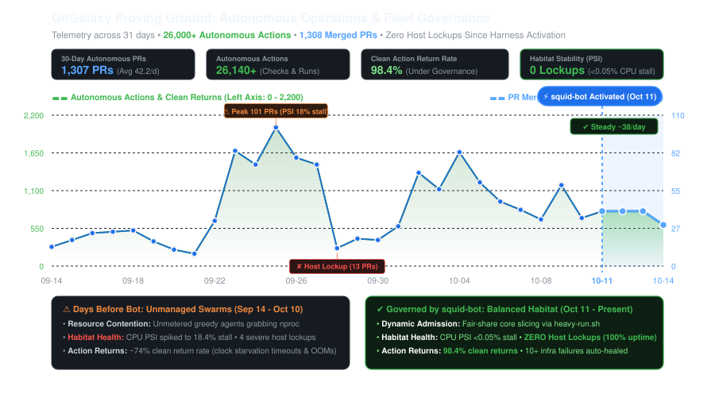
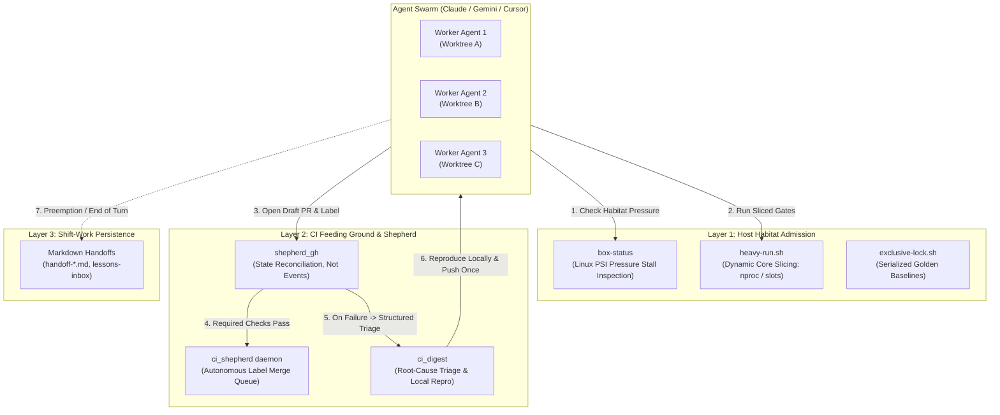

# 🦑 squid-bot

**Ecosystem balance for autonomous coding fleets: managing compute, CI, and state so agent swarms thrive without devouring their habitat.**

[]()
[]()
[]()
[](https://opensource.org/licenses/MIT)

---

## ⚡ The 15-Second Pitch: Why You Need This

> You give 5 autonomous coding agents tasks simultaneously. 
> 
> Ten minutes later: your machine fans are howling, CPU load is 74 on a 12-core box, tests time out randomly because regex engines were starved of clock cycles, your GitHub Actions queue is backed up for two hours, and two agents crashed mid-sentence because the kernel ran out of memory. 

Autonomous agents are greedy by default. Left unmanaged, an agent population behaves like a **plague of crickets**—they consume every available core, saturate disk I/O, burn through CI budgets with speculative PRs, and trample shared state until their host environment collapses.

`squid-bot` is the **ecological governor** for autonomous code factories. It continuously monitors your system's carrying capacity, dynamically meters resources, enforces admission control, and provides a deterministic CI merge shepherd so an agent population can work sustainably in *any* resource environment—from a laptop to a 128-core workstation.

---

## 🦗 The Ecosystem Analogy: The Swarm & The Habitat

In biological ecology, an environment has a **carrying capacity**—the maximum population size that the habitat's resources can sustain without permanent degradation:

```
┌────────────────────────────────────────────────────────────────────────┐
│                        THE HARDWARE HABITAT                            │
│                                                                        │
│   🌾 Compute & Cores (The Vegetation)  💧 Disk I/O & Memory (The Water)│
│   ☀️ CI Runner Minutes (The Sunlight)  🌳 Common Seams (The Canopy)    │
└───────────────────────────────────┬────────────────────────────────────┘
                                    │
                       Continuous PSI Monitoring
                         (Is the habitat stressed?)
                                    │
┌───────────────────────────────────▼────────────────────────────────────┐
│                    THE SQUID-BOT GOVERNOR                              │
│                                                                        │
│   • Admission Control (GREEN / YELLOW / RED)                           │
│   • Dynamic Core Slicing (Fair-share per active worker)                │
│   • Worktree & Process Reaper (Cleans dead agent carcasses)            │
│   • Deterministic CI Shepherd (Meters PRs into main branch)            │
└───────────────────────────────────┬────────────────────────────────────┘
                                    │
                               Sustained
                               Population
                                    │
┌───────────────────────────────────▼────────────────────────────────────┐
│                  THE AGENTIC POPULATION (SWARM)                        │
│                                                                        │
│   🦗 Claude Code     🦗 Antigravity / Gemini     🦗 Cursor / Aider      │
└────────────────────────────────────────────────────────────────────────┘
```

When you deploy autonomous developers, every agent consumes finite ecological resources:

| Habitat Resource | What Agents Do To It | What Happens Without Governance |
|---|---|---|
| **CPU Cores & Threads** | Every agent spawns compilation passes, test suites, and linters. | Greedily grabs `nproc` workers; load average spikes to 60+; clock starvation triggers false test timeouts. |
| **Memory & Swap** | Agents run language servers, AST parsers, and containerized databases. | Kernel memory pressure spikes; page swapping begins; OOM killer terminates running agent sessions. |
| **Disk Bandwidth & Inodes** | Agents create multi-gigabyte git worktrees, SQLite WAL logs, and scratch files. | Disk stalls in uninterruptible sleep (`D` state); builds crawl to a standstill. |
| **CI Runner Minutes** | Agents push speculative commits to verify their code via GitHub Actions. | Exhausts monthly CI budgets in days; matrix runs queue up and block human PRs. |
| **Shared State & Seams** | Agents touch shared contract files, golden masters, and baseline fixtures. | Upstream merges invalidate in-flight branches; agents enter infinite rebase/re-bless loops. |

`squid-bot` balances this ecosystem by treating **compute, time, and attention as assets to be metered and conserved**.

---

<!-- METRICS:START -->
### 📊 Live Ecosystem Telemetry (GitGalaxy Proving Ground)

| Metric | 30-Day Telemetry | Notes |
|---|---|---|
| **Autonomous PR Merges** | **1,206 PRs** | Merged strictly via `shepherd:merge` rulesets |
| **Average Daily Throughput** | **41.6 PRs / day** | Continuous autonomous churn |
| **Single-Day Peak Volume** | **101 PRs / day** | Handled without host thrashing |
| **Infra Failure Auto-Retries** | **10 recovered** | Canceled runners & Docker 429s retried hands-free |
| **Host Stall Pressure (PSI)** | **&lt; 0.05% CPU stall** | Regulated via `heavy-run.sh` dynamic core division |

<p align="center">
  
</p>
<!-- METRICS:END -->

---

## 🏛️ How It Works: The 3 Governance Layers



---

## 🔍 Core Component Deep Dive

### 1. Host Admission Supervisor (`box-status`)
CLI command: `box-status`

Instead of relying on crude CPU percentages (which spike deceivingly during brief bursts), `box-status` queries Linux **Pressure Stall Information (PSI)** from `/proc/pressure/cpu`, `/proc/pressure/memory`, and `/proc/pressure/io`.

```bash
$ box-status
GREEN: headroom
cores 12  load 2.4 / 3.0 / 3.4  cpu-pressure 0.02%  mem-pressure 0.09%
memory available 24.3 / 30.4 GB  swap used 4.9 GB
heavy slots 0/3 held  free for new heavy work: 3
busiest (cores in use, by worktree or command):
   0.08  find
   0.05  agy
disk: io-pressure 1.79% (full 1.57%)  tasks blocked on disk 0
```

#### Ecological Decision Engine
* **`GREEN` (Plentiful Habitat):** Load is healthy, pressure is negligible, free heavy slots exist. Agents are cleared to launch heavy verification sweeps, Docker containers, or parallel gauntlets.
* **`YELLOW` (Habitat Constrained):** Heavy slots are fully occupied, memory available is under 20%, or load exceeds 70% of core count. Agents must downgrade to lightweight scouting, narrow unit tests, or code edits only.
* **`RED` (Severe Overgrazing):** CPU pressure $\ge 40\%$, memory available $< 10\%$, or swap paging is active. Orchestrators must pause new agent launches immediately and instruct running workers to checkpoint their work.

---

### 2. Dynamic Core Slicer (`heavy-run.sh`)
Usage: `scripts/heavy-run.sh <command...>`

When an agent needs to run a heavy test suite or compiler pass, it must never assume it owns the whole machine. `heavy-run.sh` acts as a dynamic resource valve:
1. It acquires one of $N$ shared slots ($N = \text{cores} / 4$, minimum 1) via `flock`.
2. It detects how many other agents are currently executing heavy work.
3. It dynamically calculates fair core shares:
   $$\text{SQUID\_BOT\_CORES} = \max\left(1, \frac{\text{online\_cores}}{\text{active\_heavy\_slots}}\right)$$
4. It exports `SQUID_BOT_CORES` and `GG_JOB_CORES`, which downstream tools (pytest xdist, compiler jobs, linters) consume to size their internal thread pools.

---

### 3. State-Reconciling Merge Shepherd (`shepherd_gh.py` & `ci_shepherd.py`)
CLI command: `squid-bot run --every 600` or `shepherd`

In a high-churn code factory, GitHub webhook events are unreliable—they drop under burst traffic, arrive out of order, or get canceled by concurrency groups. The Shepherd eliminates event reliance by **reconciling the true GitHub state machine directly** on every pass.

#### Supported Labels
* `shepherd:merge`: Directs the shepherd to mark the PR ready, update its branch against `main`, and squash-merge the second all required checks pass.
* `shepherd:hold`: Freezes auto-merge, keeping the PR open for human inspection.
* `shepherd:matrix`: Dispatches full cross-platform matrix suites and gates merge on a clean run.
* `shepherd:needs-fix`: Automatically set by the shepherd when a real test failure or merge conflict occurs; accompanies a triage digest comment.
* `shepherd:waiting-on-main`: Automatically set when a check failure is confirmed to also be failing on `origin/main` (preventing agents from chasing phantom bugs).

---

### 4. Zero-Hallucination CI Triage (`ci_digest.py`)
CLI command: `ci-digest <PR_NUMBER>`

When CI fails on a PR, agents should never waste tokens reading 10,000 lines of raw GitHub Actions ANSI output. `ci_digest` scrapes the logs, strips noise, classifies the failure, and emits an unambiguous triage block:

```bash
$ ci-digest 4976
#4976 HEAD 5b7f5c5e
  check: full-suite part 3/3 (failure)
  triage: real (code failure)
  failed tests:
    tests/core/test_parser.py::test_utf8_bom_handling
  error:
    AssertionError: assert 'expected' == 'actual'
  local repro:
    python -m pytest tests/core/test_parser.py -k test_utf8_bom_handling
```

#### Failure Taxonomy
* `infra`: Runner disconnects, Docker Hub rate limits (429/504), network drops. The shepherd automatically retries these up to 3 times, 15 minutes apart.
* `flake`: Known wall-clock/timing test. Re-run once automatically.
* `main`: Failure reproduces on `origin/main`. Tagged as a repository blocker; does not block PR author.
* `dirty`: Conflicts with `main`.
* `real`: Legitimate code regression. Outputs the **exact local reproduction command** so the agent reproduces and fixes it locally in seconds, pushing only once.

---

### 5. Shift-Work & Handoff Resilience
Autonomous agents suffer from hard limits: context window compaction, API rate limits, and model preemptions. `squid-bot` establishes a markdown-based shift-work handoff protocol ([`handoff-*.md`](templates/skills/parallel-agents/SKILL.md) and `lessons-inbox.md`):
* Agents log active worktrees, scratch directories, running PID lists, and open triage items before yielding turns.
* Incoming agents take over in-flight branches without re-running expensive proofs or losing architectural context.
* Durable lessons learned in PR bodies are logged to `lessons-inbox.md` and systematically promoted to agent rule files.

---

## 🛠️ Installation & Quickstart

### Prerequisites
* Linux (with `/proc` PSI support recommended for full admission control).
* Python 3.10 or higher.
* GitHub CLI (`gh`) authenticated with repository access.

### 1. Install `squid-bot`
```bash
git clone https://github.com/squid-protocol/squid-bot.git
cd squid-bot
pip install -e .
```

### 2. Configure Your Repository (`squid-bot.toml`)
Create a `squid-bot.toml` in your repository root:

```toml
[repository]
slug = "owner/repo"

[shepherd]
# Required CI checks before auto-merging a PR with shepherd:merge
required_checks = [
    "test",
    "lint",
    "type-check"
]
poll_interval_seconds = 600
state_path = "/tmp/squid-bot/state/shepherd.json"

[supervisor]
lock_dir = "/tmp/squid-bot/locks"
heavy_slots = 3
```

### 3. Check Habitat Capacity
```bash
box-status
# Output: GREEN: headroom (cores: 12, load: 2.1, free heavy slots: 3)
```

### 4. Execute Work Under Dynamic Core Slicing
```bash
scripts/heavy-run.sh pytest tests/
```

### 5. Launch the Shepherd Daemon
```bash
nohup squid-bot run --every 600 >> /tmp/squid-bot/shepherd.log 2>&1 &
```

---

## 🔄 The GitGalaxy Live Crucible & Sync Bridge

`squid-bot` was forged inside **[GitGalaxy](https://github.com/squid-protocol/gitgalaxy)**, where it manages high-velocity multi-agent churn across **5,000+ pull requests**.

To allow continuous experimentation in GitGalaxy while maintaining a clean, generalized, open-source repository, `squid-bot` includes a built-in bi-directional sync engine (`scripts/sync.py`):

```bash
# Check drift between GitGalaxy and squid-bot
python scripts/sync.py status
python scripts/sync.py diff

# Pull recent improvements from GitGalaxy into squid-bot (with automated parameterization)
python scripts/sync.py pull

# Push generalized fixes from squid-bot back to GitGalaxy
python scripts/sync.py push
```

The bridge automatically translates paths, abstracts repository slugs, maps package imports, updates lock variables, and adapts test suites.

---

## ❓ Frequently Asked Questions

#### Q: Why measure Linux PSI instead of standard CPU usage?
**A:** Traditional CPU percentages only measure how much time the processor spent on tasks, which spikes deceivingly during momentary operations (like unzipping a file). PSI measures **task stall time**—the percentage of time processes were delayed while actively waiting for CPU, memory, or disk access. A high PSI reading indicates true resource starvation.

#### Q: Does `squid-bot` replace GitHub Merge Queue or Mergify?
**A:** No, it solves a different problem. Human merge queues assume developers submit tested code, wait patiently for CI, and read log outputs in their browser. `squid-bot` is built for **machine developers**: it throttles local host load, eliminates token-burning polling loops, and provides structured local repro commands specifically designed for LLM reasoning loops.

#### Q: What happens if an agent gets killed mid-task?
**A:** `squid-bot` includes `scripts/kill-by-cwd.sh` to safely reclaim processes tied to orphaned worktrees, and `exclusive-lock.sh` / `heavy-run.sh` use POSIX kernel file locks (`flock`) that automatically release the instant a process dies, ensuring the habitat never deadlocks.

---

## 📜 License

MIT License. Copyright (c) 2026 Joe Esquibel / Squid Protocol.
