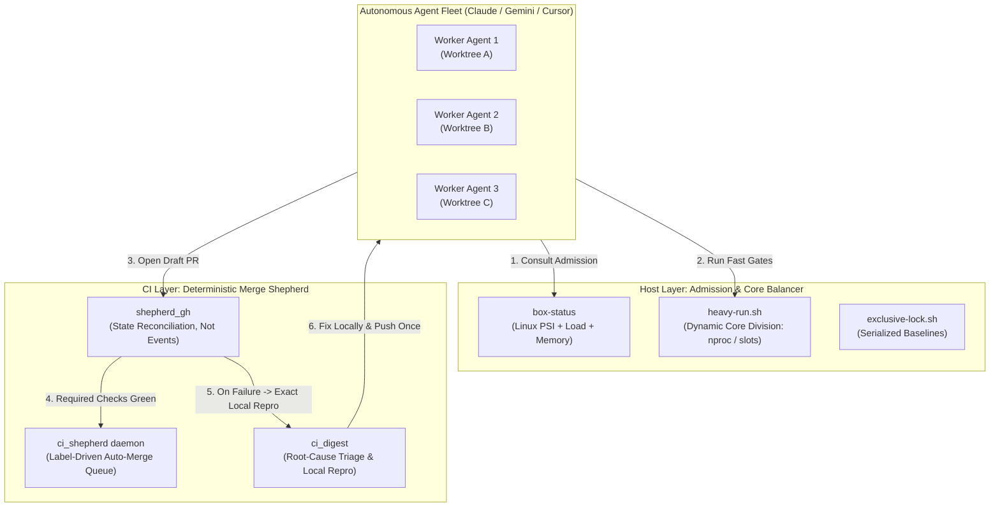

# 🦑 squid-bot

**Autonomous CI/CD Shepherd, Host Admission Supervisor & Fleet Orchestrator for AI Coding Fleets.**

[]()
[]()
[](https://opensource.org/licenses/MIT)

---

## ⚡ The Problem: The Multi-Agent Tragedy of the Commons

When you scale autonomous coding agents (Claude Code, Antigravity, Cursor background workers, OpenHands, Aider) from a single assistant to a concurrent fleet working across multiple branches, engineering bottlenecks immediately shift from **model reasoning** to **systems infrastructure**:

1. **Host Saturation & False Test Diff:** Parallel agents greedily spawn multi-threaded test runners. Load averages spike to 60–80 on a 12-core host, causing regex/IO timeouts that fake thousands of test failures.
2. **CI Burn & Queue Clogging:** Pushing speculative commits on every attempt exhausts CI minutes and clogs GitHub Actions runners with 40-minute matrix runs that could have failed in 15 seconds locally.
3. **The CI Triage Gap:** Agents given raw 10,000-line ANSI CI logs hallucinate or push speculative hope-commits instead of diagnosing the root cause.
4. **Brittle Polling Loops:** Agents running `gh pr checks --watch` or endless sleep loops hang, exhaust rate limits, or crash when webhook events drop or arrive out of order.

`squid-bot` is the **operational operating system** designed to solve this. It introduces deterministic host admission control, dynamic CPU core re-balancing, a state-reconciling CI merge shepherd, and automated local failure reproduction for AI agents.

---

## 🏛️ Architecture



### 1. Host Supervisor & Admission Control
* **`box-status`**: Reads Linux **PSI** (Pressure Stall Information) for CPU, memory, and disk I/O alongside load averages against core counts. Issues unambiguous `GREEN`, `YELLOW`, or `RED` admission verdicts before any heavy agent or test run starts.
* **`heavy-run.sh`**: Dynamic slot-based runner using `flock`. Dynamically calculates fair core shares (`SQUID_BOT_CORES = nproc / held_slots`) so concurrent workers cooperatively yield CPU cores instead of freezing the host.
* **`exclusive-lock.sh`**: Exclusive serialization for golden master updates and baseline re-blessing.
* **`kill-by-cwd.sh`**: Automatic cleanup of orphaned processes attached to deleted or completed worktrees.

### 2. The Deterministic CI Shepherd & Triage Hub
* **State Reconciliation Over Events (`shepherd_gh.py`)**: GitHub webhook events get dropped or reordered under high volume. `squid-bot` reconciles the true GitHub state (commits, rulesets, check runs, labels) on every pass.
* **Label-Driven Merging (`ci_shepherd.py`)**: Maintainers or agents add `shepherd:merge`. The shepherd monitors the PR, updates branches behind main, and squash-merges the exact moment required ruleset checks turn green.
* **Autonomous Failure Triage (`ci_digest.py`)**: Categorizes CI breakages into:
  * `infra`: Runner lost, Docker Hub 429/504, canceled — automatically re-run up to 3 times.
  * `flake`: Known wall-clock test — automatically re-run once.
  * `main`: Failure reproduces on `main` HEAD — flags as main issue, does not blame PR.
  * `dirty`: Merge conflict with `main`.
  * `real`: Code failure — extracts error lines and generates the **exact local command to reproduce**.

### 3. Agent Shift-Work Protocol
* **Stateful Handoffs**: Markdown-based handoffs (`handoff-*.md`, `lessons-inbox.md`) allowing agents to survive context limits, rate limits, and model preemptions without losing in-flight state.

---

## 🛠️ Installation & Setup

### Requirements
* Linux (with `/proc` PSI support recommended for full admission control)
* Python 3.10+
* GitHub CLI (`gh`) authenticated with repository access

### Install Locally
```bash
git clone https://github.com/squid-protocol/squid-bot.git
cd squid-bot
pip install -e .
```

### Configuration (`squid-bot.toml`)
Create a `squid-bot.toml` in your repository root or home directory:
```toml
[repository]
slug = "owner/repo"

[shepherd]
required_checks = ["test", "lint", "type-check"]
poll_interval_seconds = 600
state_path = "/tmp/squid-bot/state/shepherd.json"

[supervisor]
lock_dir = "/tmp/squid-bot/locks"
```

---

## 🚀 Usage

### Check Host Capacity
```bash
box-status
# Output: GREEN: headroom (cores: 12, load: 2.1, free heavy slots: 3)
```

### Run a Heavy Command with Dynamic Core Slicing
```bash
scripts/heavy-run.sh pytest tests/
```

### Check Pull Request Readiness
```bash
pr-check 123
pr-check 123 --digest    # Includes failure triage and local repro command
```

### Run the Background Shepherd Daemon
```bash
nohup squid-bot run --every 600 >> /tmp/squid-bot/shepherd.log 2>&1 &
```

---

## 🔄 The GitGalaxy Bridge (`scripts/sync.py`)

`squid-bot` was forged and battle-tested inside **[GitGalaxy](https://github.com/squid-protocol/gitgalaxy)** across 5,000+ PRs and high-velocity multi-agent churn.

To allow active development and experimentation to continue natively in GitGalaxy while maintaining this clean, standalone repository, `squid-bot` includes a bi-directional synchronization bridge:

```bash
# Check drift between GitGalaxy and squid-bot
python scripts/sync.py status
python scripts/sync.py diff

# Pull recent improvements from GitGalaxy into squid-bot (with automatic parameterization)
python scripts/sync.py pull

# Push generalized fixes from squid-bot back to GitGalaxy
python scripts/sync.py push
```

---

## 📜 License
MIT License. Copyright (c) 2026 Joe Esquibel / Squid Protocol.
